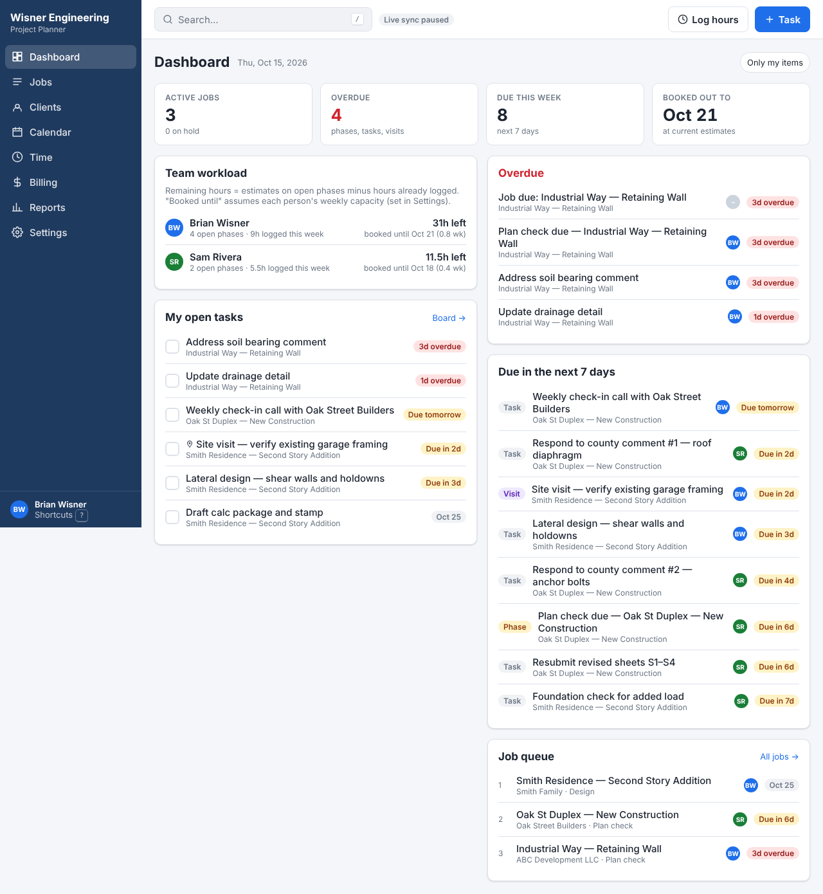
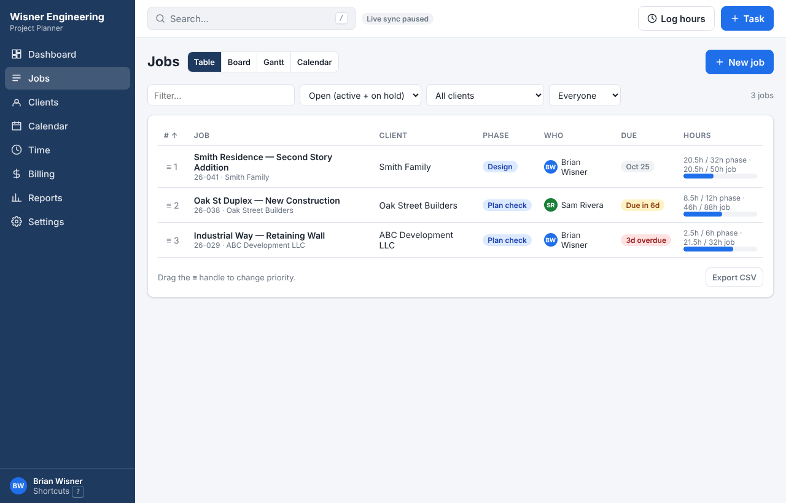
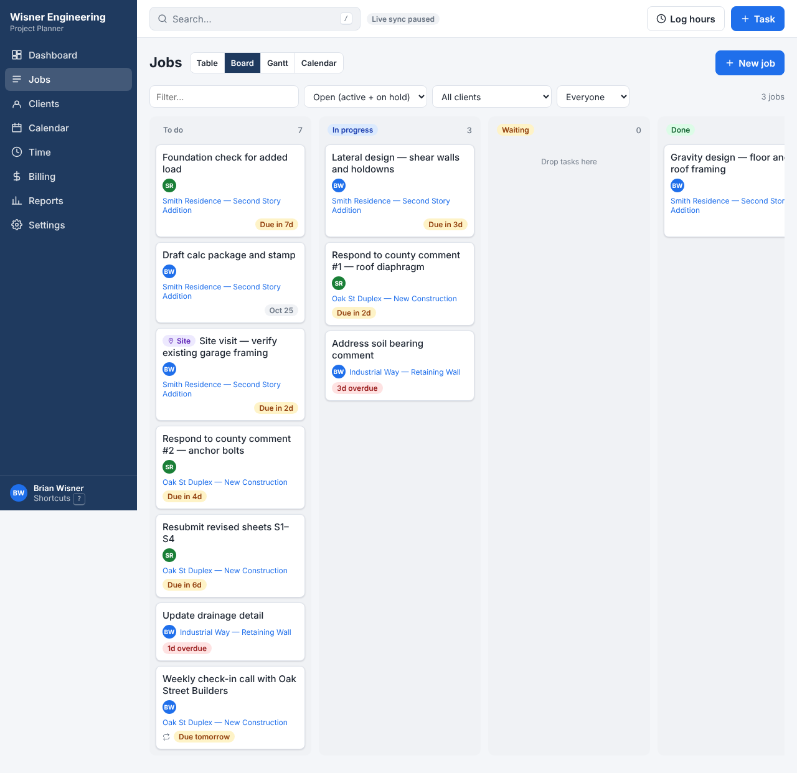
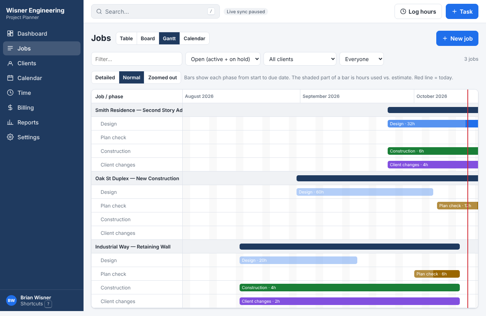
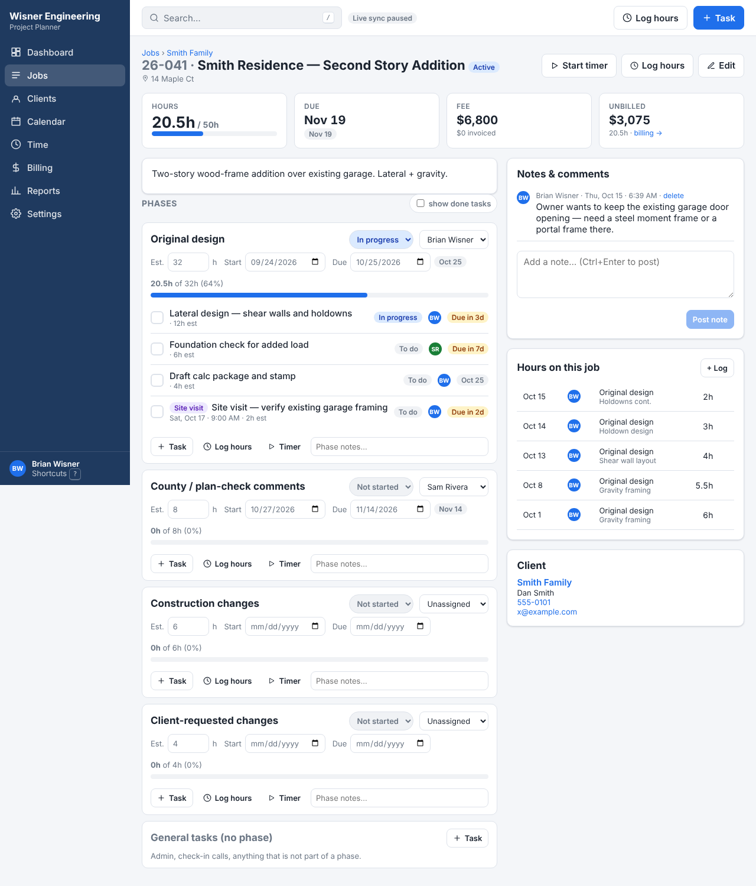
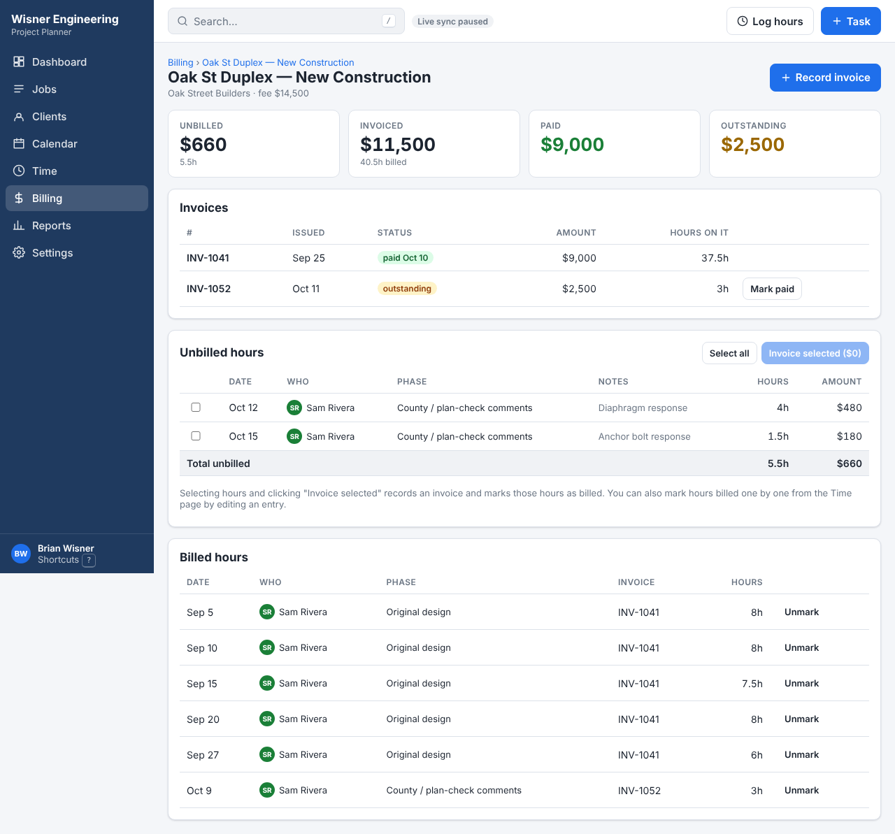
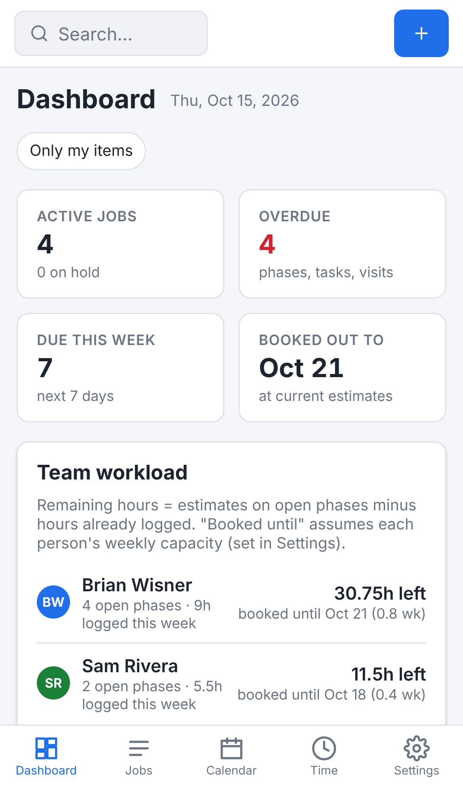

# Wisner Engineering Project Planner

A project planning app for a solo structural engineering business. It runs in any browser (desktop, laptop, iPhone, iPad), keeps your devices in sync, and is free to run.



## What it does

- **Clients → Jobs → Phases → Tasks.** Every job automatically gets six phases: Bidding, Queued, Original design, County / plan-check comments, Construction changes, Client-requested changes. Each phase has its own hour estimate, start and due dates, and status. Work is yours automatically, with no assignment step.
- **Jobs page with four views:** a prioritized **Table** (drag the ≡ handle to reorder the queue), a **Board** (drag task cards between To do / In progress / Waiting / Done), a **Gantt** timeline for long-range planning, and a **Calendar**.
- **Dashboard:** overdue deadlines and open tasks first, upcoming deadlines, job queue, your workload and booked-out date, and work needing billing.
- **Time tracking:** start/stop timer or type hours against a job, phase and task. Timesheet by week. Actual vs. estimate on every phase.
- **Billing:** per job, see unbilled hours (× hourly rate) and other charges (mileage, printing, fees…), invoiced, paid and outstanding. Select hours and charges → record an invoice → they're marked billed.
- **Reports:** hours by job and client; estimate vs. actual; all exportable to CSV.
- **Google Calendar:** a private calendar feed that Google Calendar subscribes to, plus "Download .ics" and per-item "Add to Google Calendar" links.
- **Also:** notes on each job, global search (press `/`), filters, due-date reminders, recurring tasks, quick-add (press `n`), keyboard shortcuts (press `?`), CSV export.

| Jobs table | Board | Gantt |
|---|---|---|
|  |  |  |

| Job detail | Billing | Phone |
|---|---|---|
|  |  |  |

## How it's built (plain English)

- **The app itself** is a website made with React. It is hosted for free on **GitHub Pages**, straight from this repository. Every time code is pushed to the main branch, GitHub rebuilds it and publishes it to the `gh-pages` branch automatically (see `.github/workflows/deploy.yml`).
- **The data** (clients, jobs, hours, invoices…) lives in **Supabase**, a hosted database with built-in logins and live syncing. The free plan is plenty for a small team. The project is called `wisner-planner`.
- **Your login** is email + password. New tasks, time entries, and planned hours use your account automatically.
- The web address is: **https://brianwisner.github.io/Who-knows/**
- The connection between the website and the database is the file `planner/.env.production`. It holds the project address and the *publishable* key, which Supabase designs to be visible inside a website. All data sits behind the login and row-level security, so this key alone cannot read anything.

---

## Setup status

This has already been done for you:

- [x] Supabase project created, tables built, security and live sync turned on, sample data loaded
- [x] Calendar feed function (`ics`) deployed in Supabase
- [x] Owner login created (the first account automatically gets the sample jobs assigned to it)
- [x] App connected to the database and published by the deploy workflow

- [x] **GitHub Pages is live** at https://brianwisner.github.io/Who-knows/, served from the `gh-pages` branch.

### Put it on your phone and iPad

- **iPhone / iPad:** open the address in Safari, tap the **Share** button, then **Add to Home Screen**. It then opens full-screen like an app.
- **Android:** open in Chrome → menu (⋮) → **Add to Home screen**.
- **Desktop:** just bookmark it. In Chrome you can also click the install icon in the address bar.

### Google Calendar sync

In the app go to **Settings → Google Calendar sync**, click **Copy link**, then click the Google Calendar button and paste the link into **URL of calendar** → **Add calendar**. Deadlines and site visits then appear in Google Calendar on every device; Google refreshes subscribed calendars every few hours. The feed includes your business deadlines and visits. The **Calendar** page also has **Download .ics** and per-item **Add to Google Calendar** links.

---

## Everyday use

- **Start a job:** Jobs → **New job**. Pick the client, give it a name, optional fee and due date. The six phases are created for you, starting with Bidding. Then open the job and fill in each phase's estimate and dates.
- **Change a job's status:** use the status dropdown beside its name on the job page or Jobs table. **Cancelled** removes the job from open work, deadlines, and planned capacity while keeping hours, charges, invoices, and notes. Find it with the **Cancelled** status filter; choose **Active** to reopen it.
- **Plan hours in the table:** Jobs → Table with **Plan hours** on. Each job has a box for every day of the week; type hours to schedule them on the job's current phase and clear a box to remove them. Use the arrows to change weeks and **Weekends** to show Saturday and Sunday. The bottom row is your total per day.
- **Plan hours on the Gantt:** Jobs → Gantt. Drag across days on a phase row (or tap a day on a phone) and enter hours for each day, e.g. 4 on Wednesday and 2 on Thursday. The top row shows how many hours you have scheduled each day (yellow = more than a full day). Click the arrow beside a job to roll its phases up.
- **Bidding and queue:** while you're pricing a job, keep the Bidding phase in progress. When the client says yes, mark Bidding complete and set Queued to in progress; the job's **Entered queue** date fills in with today (change it in **Edit job** if it was earlier). The job page and Jobs table show how many days it has been waiting, and the Gantt shows a teal diamond on that date.
- **Prioritize:** on the Jobs table, drag the **≡** handle to reorder. Number 1 is the top of the queue.
- **Daily list:** Dashboard → *Open tasks*, or Jobs → Board.
- **On your phone:** use **More** in the bottom navigation for Clients, Billing, Reports, and Settings. **Log hours** and **Add task** are always in the top bar.
- **Log time:** press **t** anywhere, or click **Start timer** on a job. Stop it from the green pill at the top.
- **Take a deposit:** on the job page click **Deposit** (or Billing → **Record deposit**), enter the amount and date.
- **Add a charge (not hours):** on the job page click **Charge** (or Billing → the job → **Add charge**). Pick a type (expense, mileage, printing, permit fee, site visit, fixed fee, other), the quantity and price. Charges are billed, paid by deposits and counted in the balance just like hours.
- **Job balance:** every job shows deposits + billed − the value of work (hours × billing rate, plus charges). It goes down as hours are logged and back up when a deposit comes in or an invoice goes out. Red means you've done work nobody has paid for or been billed for yet.
- **Bill a job:** Billing → click the job → **Bill everything not billed** (or tick specific hours and charges → **Invoice selected**) → enter the invoice number. Later, click **Mark paid**.
- **Which hours are paid:** every hour is marked *Paid by deposit*, *Not billed*, *Billed, not paid*, or *Paid*. Billing → **Hours** lists them across all jobs with filters and CSV export. Deposits pay for hours automatically, oldest first.
- **Rates:** each time entry keeps the rate it was logged at, so changing someone's rate in Settings only affects new hours. You can change one entry's rate from the job's Billing page.
- **Site visits:** make a task, tick **Site visit**, give it a date and time. It shows up purple on the calendar and in Google Calendar.
- **Repeating tasks:** set **Repeats** on a task. When you tick it done, the next one is created automatically.
- **Reminders:** Settings → **Turn on reminders on this device**. Once a day when you open the app, you get a notification of anything overdue or due today.
- **Remove the sample data:** Settings → **Remove sample data**.

Keyboard shortcuts (desktop): `n` new task · `/` search · `t` log hours · `g` then `d`/`j`/`c`/`a`/`t`/`b`/`r` to jump to Dashboard/Jobs/Clients/Calendar/Time/Billing/Reports · `?` help.

## Making changes later

Open this repository in Codex and describe what you want in plain English ("add a Permit number field to jobs", "make the calendar easier to read"). `AGENTS.md` records the solo-business direction, and `CLAUDE.md` explains how the code is organized.

## For developers

```
cd planner
cp .env.example .env     # fill in your Supabase URL + key
npm install
npm run dev              # http://localhost:5173/Who-knows/
npm run build            # production build into dist/
```

Stack: Vite + React + TypeScript, Supabase (Postgres, Auth, Realtime, Edge Functions), @dnd-kit for drag and drop, date-fns. No CSS framework; styles are in `src/index.css`.
